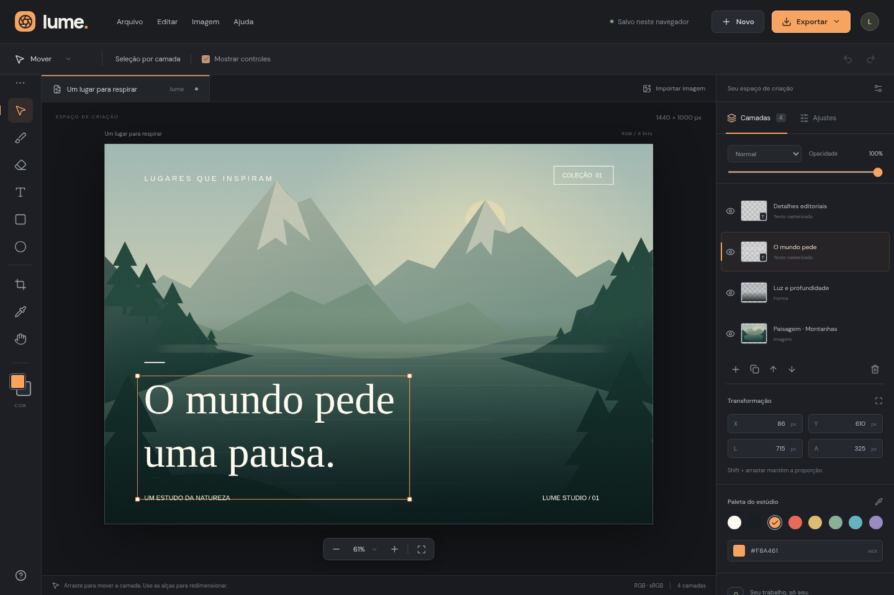

# Lume — Estúdio de imagens

Editor de imagens no navegador, construído com React, TypeScript e Canvas 2D. A interface está em português. O processamento e o salvamento automático acontecem no dispositivo, sem upload de imagens.

## Abrir sem instalar nada

**[Baixar o Lume para computador (.zip)](https://github.com/spl1805/Malafaia/raw/refs/heads/lume-image-editor/releases/Lume-portatil.zip)**

No GitHub, esta versão está na branch `lume-image-editor`. Depois de baixar, extraia o ZIP e abra `Lume.html` com Chrome ou Edge. Se a página mostrar o arquivo no GitHub, use o botão **Download raw** (ícone de download).

Baixe o arquivo [Lume.html](releases/Lume.html) e abra-o em um navegador de computador, como Chrome ou Edge. Ele inclui o aplicativo, as fontes e a ilustração; não exige Node.js, servidor nem conexão com a internet para editar e exportar imagens. O HTML precisa ser aberto como uma página no navegador, não no visualizador de texto ou de anexos do chat.

Também há um [ZIP para download](releases/Lume-portatil.zip): extraia a pasta e abra `Lume.html` com Chrome ou Edge.

Para gerar novamente esse arquivo a partir do código:

```bash
npm ci
npm run build:portable
```

O resultado fica em `releases/Lume.html`. Esse formato é separado do build web em `dist/`.

Para gerar também o ZIP com as instruções de abertura, execute `npm run package:portable` (a compactação usa Python 3, já disponível neste ambiente).

O teste da versão portátil fornece apenas o HTML ao navegador, com a rede desativada, e verifica edição, histórico e exportação sem recursos externos. A abertura direta por `file://` não pode ser testada no Chromium desta máquina, pois está bloqueada pela política do navegador da nuvem.



## Executar

Requer Node.js 22 ou superior e npm.

```bash
cd /workspace/Malafaia
npm ci
npm run dev -- --port 5173
```

O servidor escuta na porta 5173. Para gerar uma versão estática de produção:

```bash
npm run build
npm run preview -- --port 4173
```

Os arquivos de produção ficam em `dist/`. Fontes, ícones e a ilustração de demonstração são servidos pelo próprio aplicativo; o uso do editor não requer serviços externos.

## O que funciona

- Documentos com fundo branco ou transparente, dimensões personalizadas e três formatos predefinidos.
- Importação de PNG, JPEG, WebP, GIF e AVIF por arquivo, arrastar e soltar ou colagem. Imagens animadas são rasterizadas em um quadro.
- Pincel, borracha, conta-gotas, retângulos, elipses e inserção de texto em três famílias de fontes.
- Camadas com seleção, visibilidade, bloqueio, opacidade, duplicação, exclusão e ordenação.
- Movimento, redimensionamento com alças, posições e dimensões numéricas. Shift mantém a proporção ao redimensionar.
- Brilho, contraste e saturação por camada; quatro pontos de partida para ajustes.
- Recorte com grade de terços, zoom e navegação com a ferramenta Mão.
- Desfazer/refazer com até 20 estados, limitado a aproximadamente 48 MB de histórico serializado.
- Exportação PNG com transparência e JPEG com qualidade ajustável e fundo branco.
- Salvar e abrir projetos `.lume`, preservando pixels, camadas e ajustes.
- Recuperação do último documento via IndexedDB. Aguarde o indicador “Salvo neste navegador” antes de fechar. Salve também um arquivo `.lume` para manter uma cópia independente dos dados do navegador.
- Interface adaptável para celular, com botão para abrir/fechar o painel de camadas.

## Atalhos

| Ação                                      | Atalho                   |
| ----------------------------------------- | ------------------------ |
| Mover / Pincel / Borracha                 | V / B / E                |
| Texto / Retângulo / Elipse                | T / U / O                |
| Recortar / Conta-gotas / Mão              | C / I / H                |
| Mão temporária                            | Espaço                   |
| Tamanho do pincel                         | [ / ]                    |
| Desfazer / Refazer                        | Ctrl Z / Ctrl Shift Z    |
| Salvar projeto                            | Ctrl S                   |
| Importar imagem / Novo documento          | Ctrl O / Ctrl N          |
| Duplicar / Excluir camada                 | Ctrl D / Delete          |
| Mover camada em 1 px / 10 px              | Setas / Shift + setas    |
| Ajustar à tela / Aumentar / Diminuir zoom | Ctrl 0 / Ctrl + / Ctrl - |
| Confirmar / Cancelar recorte              | Enter / Esc              |

No macOS, use Command no lugar de Ctrl.

## Validação

```bash
npm run build
npm test
```

Os testes Playwright usam Chromium em `/usr/bin/chromium`, disponível neste ambiente. Para outro local, defina `CHROMIUM_PATH`. Eles exercitam pixels pintados/apagados, histórico, camadas, texto, ajustes, importação, exportação PNG/JPEG, projetos, recorte, rejeição de projetos inválidos e interface móvel.

## Limites desta versão

Este é um primeiro editor funcional inspirado no fluxo de edição por camadas. Não há suporte a PSD/RAW, CMYK, máscaras, seleções complexas, objetos inteligentes, modos de mesclagem adicionais ou preenchimento com IA. O texto é rasterizado ao ser inserido; para alterar o conteúdo, remova a camada e insira outro texto. Não há conta, colaboração ou sincronização em nuvem.

Documentos: até 4096 px por dimensão e 16 megapixels. Projetos: até 40 camadas. Importação de imagens: até 30 MB por arquivo, ajustadas para caber no documento. Projetos `.lume`: até 100 MB. Documentos maiores e muitas camadas podem consumir bastante memória.

A ilustração de paisagem incluída foi criada para a demonstração e pode ser substituída por uma imagem importada.
